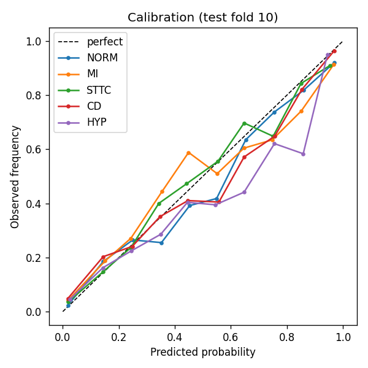
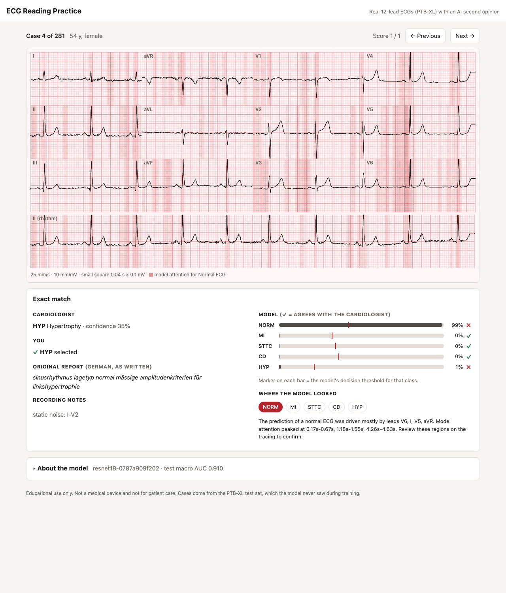
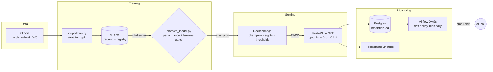

# ECG Clinical Action Recommender

[](https://github.com/heisenberg1804/ECG-Clinical-Action-Recommender-MLops/actions/workflows/ci.yml)
[](LICENSE)

An end-to-end MLOps system that classifies 12-lead ECGs into five diagnostic
superclasses and explains which leads and time segments drove each prediction,
served through **ECG Reading Practice**, a learner UI where medical students read
real ECGs and compare their read with the cardiologist and the model. It's built
around reproducibility: every served model can be traced to the exact code, data
version and evaluation that produced it.

> **Not a medical device.** This is a portfolio and research project. The
> suggested actions come from a hand-written rule table, not clinical guidelines,
> and nothing here should inform patient care.

---

## Results

The model is a 1D ResNet-18 trained on [PTB-XL](https://physionet.org/content/ptb-xl/1.0.3/).
It's evaluated on **fold 10 of PTB-XL's patient-wise stratified split**, so no
patient appears in both training and test (n = 2,158 ECGs).

| Class | AUC | F1 | Sensitivity | Specificity | ECE |
|---|---|---|---|---|---|
| NORM (normal) | 0.943 | 0.86 | 0.92 | 0.82 | 0.031 |
| MI (myocardial infarction) | 0.930 | 0.76 | 0.79 | 0.90 | 0.039 |
| STTC (ST/T change) | 0.931 | 0.76 | 0.80 | 0.91 | 0.022 |
| CD (conduction disturbance) | 0.917 | 0.75 | 0.74 | 0.93 | 0.033 |
| HYP (hypertrophy) | 0.828 | 0.46 | 0.58 | 0.87 | 0.032 |
| **Macro** | **0.910** | | | | |

F1, sensitivity and specificity use per-class thresholds tuned on the validation
fold (fold 9), never on test. For context, the published PTB-XL benchmark reports
macro AUCs of about 0.92–0.93 for the strongest 1D CNNs on this task and split
(Strodthoff et al.).

**Fairness: macro AUC by subgroup, measured against ground-truth labels**

| Male | Female | Age < 40 | Age 40–65 | Age > 65 |
|---|---|---|---|---|
| 0.919 | 0.899 | 0.917 | 0.898 | 0.896 |

The model is about 2 AUC points worse for women and for patients over 40. The
largest gap (0.024) is inside the release gate (0.05), but it's a real
limitation and is tracked for every model.

**Calibration.** Predicted probabilities track observed frequencies closely
(ECE ≤ 0.04 per class). HYP is somewhat overconfident in the 0.7–0.85 range.



### Why these numbers are lower than earlier versions of this README

An October 2026 audit found that the previously reported 93–94% AUCs were
inflated:

- **Random splits leaked patients.** PTB-XL has several ECGs from many patients.
  A random 80/20 split put about 17% of test records next to the same patient's
  ECGs in training.
- **The ensemble's "test" set was mostly training data.** It was re-split with
  different settings, so 72% of its test records had been used to train one of
  its member models.
- **The served model wasn't the one reported.** The API ran a single ResNet,
  not the ensemble.

The pipeline was rebuilt around the dataset's official patient-wise folds. The
0.910 above is the number that holds up.

---

## Learner UI: ECG Reading Practice



Medical students practise on **281 real 12-lead ECGs from the PTB-XL test fold**, which the model never saw in training:

1. **Read**: the ECG in the standard 3×4 layout plus a 10 s rhythm strip, on ECG paper (25 mm/s, 10 mm/mV).
2. **Commit**: select the categories you see.
3. **Reveal**: the cardiologist's labels with their confidence, the original report, recording-quality notes, and the model's probability for each class against its decision threshold.
4. **Learn where to look**: pick any class, and the model's attention is shaded on the tracing.

About a quarter of the cases (15 per class) are ones **the model gets wrong**, chosen deliberately, as in the screenshot above. An "About the model" card shows per-class and per-group performance, calibration, lineage and limitations, derived from the served model's metrics.

Run it with `make serve`, then open http://localhost:8000/ (it redirects to `/app/`). After promoting a new model, rebuild the cases with `make case-bank`; CI fails if the committed cases don't match the committed model.

*Next:* a tutor chat that can operate on the case and the model ("cover lead III: does it still say MI?"). See D-53 to D-60 in the [decision record](docs/DECISIONS.md).

---

## Architecture



### MLOps practices

Every choice below, with its reasoning, trade-offs and rejected alternatives, is
recorded in [docs/DECISIONS.md](docs/DECISIONS.md).


| Concern | How it's handled | Where |
|---|---|---|
| Data versioning | PTB-XL tracked with DVC (md5 recorded on every run) | `data/ptb-xl.dvc` |
| Leak-free evaluation | PTB-XL `strat_fold`: train 1–8, validation 9, test 10 | `src/ml/training/data.py` |
| Experiment tracking | Config, per-epoch curves, per-class, subgroup and calibration metrics | `src/ml/training/train.py` |
| Lineage | Git commit, dirty flag, DVC hash and split are tagged on every run; `model_version` is the weights' sha256 | MLflow tags, `models/model_meta.json` |
| Model registry | New models register as `ecg-resnet1d@challenger` | MLflow |
| Release gates | Promote only if test AUC ≥ champion's and the subgroup AUC gap ≤ 0.05 | `scripts/promote_model.py` |
| No train/serve skew | Training and the API call the same `prepare_ecg()` | `src/ml/preprocessing/signal.py` |
| Explainability | Grad-CAM (when) plus gradient × input (which leads), computed on the exact input that was scored | `src/ml/explainability/explainer.py` |
| CI | Lint, 41 tests, kustomize render and Docker build on every PR | `.github/workflows/ci.yml` |
| CD | Runs only after CI passes on `main`; smoke test, then automatic rollback on failure | `.github/workflows/cd.yml` |
| Monitoring | Every prediction logged to Postgres; Evidently drift and fairness DAGs in Airflow with email alerts | `src/monitoring/`, `airflow/dags/` |
| Secrets | Nothing secret in git; credentials come from gitignored env files and k8s Secrets | `*.example` files |

---

## Quickstart (local)

**Prerequisites:** Python 3.11, [uv](https://docs.astral.sh/uv/), Git LFS, and
optionally Docker.

```bash
git clone https://github.com/heisenberg1804/ECG-Clinical-Action-Recommender-MLops.git
cd ECG-Clinical-Action-Recommender-MLops
git lfs pull                      # model weights
uv sync --all-extras
```

**Get the data.** The DVC remote is being rebuilt, so download PTB-XL 1.0.3 from
PhysioNet (1.8 GB download, 3 GB unzipped):

```bash
mkdir -p data/ptb-xl && cd data/ptb-xl
curl -LO https://physionet.org/static/published-projects/ptb-xl/ptb-xl-a-large-publicly-available-electrocardiography-dataset-1.0.3.zip
unzip -q ptb-xl-*.zip && cd ../..
uvx dvc status                    # confirms it matches the tracked version
```

**Train, inspect, promote:**

```bash
uv run python scripts/train.py --limit 256 --epochs 1 --no-register   # 2-minute smoke test
uv run python scripts/train.py                                        # full run (~1.5 h on Apple M-series)
uv run mlflow ui --backend-store-uri sqlite:///mlflow.db --port 5001
uv run python scripts/promote_model.py --dry-run                      # check the gates
uv run python scripts/promote_model.py                                # promote + export to models/
```

**Serve:**

```bash
uv run uvicorn src.api.main:app --reload
open http://localhost:8000/docs
```

Prediction logging needs Postgres (`docker compose -f docker/docker-compose.yml up -d db`).
Without it, predictions still work and logging fails quietly. For the monitoring
DAGs, see the header of `docker/docker-compose.airflow.yml`.

---

## API

| Method | Path | Purpose |
|---|---|---|
| `POST` | `/predict` | 12-lead ECG (≥ 10 s, any sampling rate from 100–2000 Hz) → class probabilities, diagnoses, suggested actions, optional explanation |
| `GET` | `/app/` | Learner UI (the root `/` redirects here) |
| `GET` | `/cases`, `/cases/{id}` | Practice cases: the list, and an ECG without its answer |
| `POST` | `/cases/{id}/reveal` | Student's read in → cardiologist label, model output, per-class agreement |
| `GET` | `/cases/{id}/explanation/{class}` | Model attention for one class (per lead and over time) |
| `GET` | `/model/card` | Served model's metrics, subgroups, calibration, lineage, limitations |
| `GET` | `/model/info` | Model version, classes, device |
| `GET` | `/health` | Liveness check |
| `GET` | `/ready` | Readiness: returns 503 until the model is loaded |
| `GET` | `/monitoring/drift/status`, `/monitoring/bias/status` | Monitoring summaries from the prediction log |
| `GET` | `/metrics` | Prometheus metrics |

Real output for PTB-XL record 210 (test fold, labelled inferior MI):

```jsonc
// POST /predict  {"ecg_signal": [[...5000 floats...] x 12], "sampling_rate": 500, "explain": true}
{
  "model_version": "resnet18-0787a909f202",
  "probabilities": {"NORM": 0.31, "MI": 0.48, "STTC": 0.00, "CD": 0.20, "HYP": 0.01},
  "diagnoses": [{"diagnosis": "MI", "confidence": 0.48}],      // MI threshold is 0.32
  "recommendations": [{"action": "Activate cath lab", "urgency": "immediate", "...": "..."}, "..."],
  "explanation": {
    "important_leads": ["II", "V2", "aVF", "V1"],
    "important_segments": [{"start_s": 1.79, "end_s": 2.02, "peak": 0.97}, "..."],
    "heatmap": "12 x 500 per-lead attribution at 50 Hz",
    "description": "The prediction of myocardial infarction was driven mostly by leads II, V2, aVF, V1. ..."
  }
}
```

Two of the top leads (II, aVF) are inferior leads, which fits the label. The
example also shows the limitation of the action table: a 0.48-confidence MI
maps straight to "Activate cath lab".

---

## Deployment

Kubernetes manifests (`k8s/`) come in two flavours: a self-contained local
stack (API, Postgres, MLflow) for minikube, and a GKE overlay that swaps in
Cloud SQL (through the Auth Proxy) and GCS, with Workload Identity throughout.
MLflow on GKE uses Cloud SQL as its backend store and GCS for artifacts.
Infrastructure is Terraform (`infra/`); see [infra/README.md](infra/README.md).

**Current status: torn down.** The original GCP project was shut down to stop
idle costs. It's being rebuilt with Terraform as *ephemeral* infrastructure:
brought up for demos, destroyed afterward, with a budget-triggered kill switch.
Until then, CD stays off through the `DEPLOY_ENABLED` repository variable, and
`scripts/gcp_inventory.sh <project>` checks that nothing billable is left
running.

---

## Project structure

```
src/
  api/                  FastAPI app, routes (predict, cases, model card, health, monitoring)
    static/             learner UI: Preact + htm + uPlot, vendored, no build step
  casebank/             builds and loads the precomputed practice-case bank
  ml/
    models/             1D ResNet
    preprocessing/      prepare_ecg(), shared by training and serving
    training/           data pipeline, metrics, MLflow training loop
    inference/          predictor, action rule table
    explainability/     Grad-CAM + gradient x input, optional local LLM phrasing
  monitoring/           Evidently drift, fairness analysis
  db.py                 env-driven Postgres DSN
models/                 champion weights + model_meta.json, case_bank/ (Git LFS)
scripts/                train, promote, case bank, ensembles, gcp_inventory, deploy
airflow/dags/           drift (hourly) and bias (daily) monitoring
k8s/                    kustomize: base (local stack) + prod overlay (GKE)
infra/                  Terraform: foundation (cost guardrails) + platform (GKE, Cloud SQL)
docker/                 API image, local compose stacks
tests/unit/             API, inference, explainability, training, preprocessing
```

---

## Limitations and roadmap

- **HYP is weak** (AUC 0.83, F1 0.46), and the model is less accurate for
  women and older patients. Both reproduce on every seed. Training-time
  augmentation helps every seed (+0.003 macro AUC), and an augmented 3-seed
  ensemble reaches **0.920** (D-62). Serving changes once the experiment program
  finishes (D-51).
- **The action table is illustrative.** PTB-XL's MI labels don't separate acute
  from old infarction, so "activate cath lab" is not a supportable output from
  this model.
- **Monitoring needs work.** Drift currently watches metadata and output
  distributions, not the ECG signal itself. The live bias check uses demographic
  parity, which flags real prevalence differences; label-based checks like the
  training-time subgroup AUC are the goal.
- **The live demo is ephemeral by design.** It's brought up for interviews with
  `make demo-up` (about $0.35 per demo) and torn down afterward; see
  [infra/README.md](infra/README.md).

---

## References

- Wagner et al., *PTB-XL, a large publicly available electrocardiography dataset*, Scientific Data, 2020.
- Strodthoff et al., *Deep Learning for ECG Analysis: Benchmarks and Insights from PTB-XL*, IEEE JBHI, 2021.
- Selvaraju et al., *Grad-CAM: Visual Explanations from Deep Networks via Gradient-based Localization*, ICCV 2017.

## Author

**Sahil Mohanty** · [GitHub @heisenberg1804](https://github.com/heisenberg1804) · [LinkedIn](https://linkedin.com/in/sahil-mohanty)

Licensed under the [MIT License](LICENSE).
